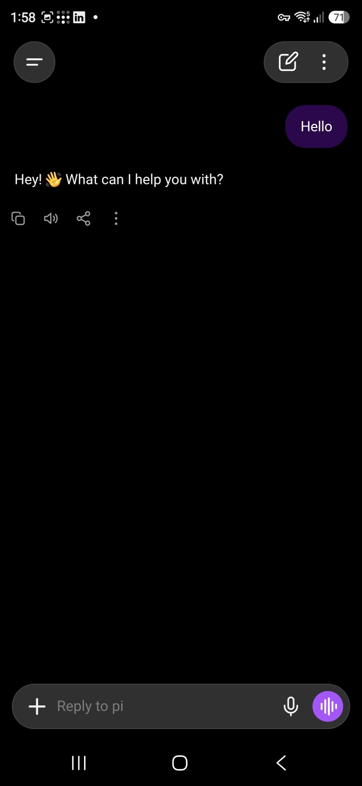
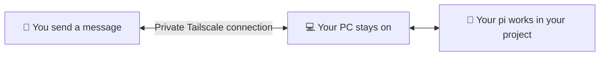

<p align="center"></p>

<h1 align="center">Your pi. Your projects. In your pocket.</h1>

<p align="center"><strong>Ask from your sofa. Follow along over coffee.<br />Your coding assistant keeps working on your PC.</strong></p>

<p align="center">Install as a Pi package · Guided setup · Project-based chats · Live replies · Your own AI account</p>

## 💜 Your next idea doesn't have to wait for your desk

Give pi a task from your phone. Watch its reply arrive. Check what it changed, send another thought, or return to a project you started yesterday.

**connect-pi turns your existing pi installation into a phone-friendly workspace.**

- **One place for your projects.** Conversations stay grouped by their folder on your PC.
- **Follow the work live.** Read replies and expand thinking, commands and file edits.
- **Stay in control.** Send a follow-up while pi is working, or tap Stop.
- **Pick up where you left off.** Continue saved chats or start fresh in the same folder.
- **Keep your own setup.** Use pi's saved AI account and your own computer.
- **Set up inside pi.** Choose a project folder and passcode through a guided wizard.

<p align="center">


</p>

*Screenshots supplied for this guide. Your conversations and folders will be your own.*

> Independent companion for pi. The interface is ChatGPT-inspired; this is not a ChatGPT product.

## 🧭 How it works



**Your phone sends the message. Your PC does the work. The answer appears on your phone.**

Your PC must stay switched on, awake and connected. Your AI provider's usual charges and limits still apply.

## ✅ Before you begin

| You need | What to do |
| --- | --- |
| A Windows PC | This is the supported desktop setup. macOS/Linux are not verified as complete desktop experiences. |
| pi already working | Open `pi`, use `/login` if needed, and check that it answers a message. |
| Node.js 22.19 or newer | Install [Node.js LTS](https://nodejs.org/en/download). Check with `node --version`. |
| A current phone browser | Chrome on Android or Safari on iPhone. Android is the main UI reference; iPhone behavior can differ. |
| Tailscale on both devices | [Install Tailscale](https://tailscale.com/download), sign into the same account, and keep it connected. |
| Repository access | This repository is private. Other people need an invitation and must sign into the invited GitHub account. |
| Git, for the recommended install | Install [Git for Windows](https://git-scm.com/downloads/win). Git must be able to access this private repository. |

For a fresh pi installation, follow [pi's official guide](https://github.com/earendil-works/pi/tree/main/packages/coding-agent). The Windows instructions here use an npm-installed pi; custom/standalone pi installations may need extra configuration.

**Phone connection, once per device:** enable HTTPS through [Tailscale's setup guide](https://tailscale.com/docs/how-to/set-up-https-certificates). If Tailscale shows an approval link for Serve, open it and approve the private connection. The wizard cannot sign into your accounts for you.

## 🚀 Choose your setup: easiest first

| Method | Best for |
| --- | --- |
| **1. Install as a Pi package** | Recommended. No ZIP or manual settings-file edits. |
| **2. Ask pi to help** | Have your assistant check prerequisites and prepare the installation. |
| **3. Download, then install locally** | Prefer a ZIP or already have a checkout on your PC. |
| **4. Manual setup** | Prefer terminal commands and a desktop shortcut. |

All four methods connect to **your own pi on your own PC**.

<a id="install-pi-package"></a>

## 1. 📦 Install as a Pi package — recommended

### On your PC

Open a terminal and run:

```powershell
pi install git:github.com/vermaankit2005/connect-pi
```

If GitHub refuses access, check that your Git credentials can access the repository. Alternatively use the ZIP method below. There is no published npm package to install by name; this command installs from GitHub using [Pi's package support](https://github.com/earendil-works/pi/blob/main/packages/coding-agent/docs/packages.md).

Open pi in a project folder. If it was already open, type `/reload`.

Then, **inside pi**, enter:

```text
/phone setup
```

The wizard will:

1. Ask which existing folder your phone should browse. Enter its full path, or press Enter to use the current project folder.
2. Ask you to choose and repeat a **6-digit passcode**, unless one is already set. Enter it directly in the dialog; don't ask the AI to choose it.
3. Offer to start the phone connection now.
4. Show your phone address once Tailscale is ready.

**Already used an older manual installation?** Use `/connect-pi setup` if `/phone` is ambiguous or shows the old status command. Setup backs up the recognized legacy copied extension; run `/reload` afterwards. `/connect-pi` and `/phone` otherwise offer the same commands.

### On your phone

1. Connect Tailscale.
2. Open the **`https://…ts.net`** address shown by pi in your browser.
3. Unlock with the passcode you chose.
4. Open the top-left menu. Projects is the starting view.

**That's your connection ready.** Continue with [your first task](#-your-first-task).

> `/phone start` runs the connection in the background. Closing pi does **not** stop it. Use `/phone stop` when you're done. This also stops phone-started sessions; saved conversations remain.

## 2. 💬 Ask pi to help you set it up

Paste this into a pi session on the PC you want to use:

> Set up connect-pi from https://github.com/vermaankit2005/connect-pi on this computer. Read its README, check Node, Git, repository access and my existing pi installation, and install it as a Pi package. Reuse my existing pi login. Tell me when to run /reload and /phone setup. Guide me through Tailscale sign-in and HTTPS approval when needed. I will enter my own passcode in the setup dialog. Do not upload conversations, screenshots, credentials or local configuration files.

pi can prepare and troubleshoot the installation. You still complete account sign-ins and the setup dialogs yourself. Once installed, use the same phone steps as method 1.

## 3. 📂 Download, then install locally

### Option A: download a ZIP

1. Open [this repository](https://github.com/vermaankit2005/connect-pi) while signed into an invited GitHub account.
2. Choose **Code → Download ZIP**.
3. Right-click the ZIP, select **Extract All**, and open the extracted folder containing `package.json`.
4. Move it somewhere permanent. Don't delete this folder after setup.
5. Right-click an empty area inside it and choose **Open in Terminal**.

### Option B: clone with Git

```powershell
git clone https://github.com/vermaankit2005/connect-pi.git
```

```powershell
cd connect-pi
```

### Install the local copy

Run these one at a time from the app folder:

```powershell
npm.cmd install
```

```powershell
pi install .
```

Local Pi packages use the folder in place, which is why it must stay where you put it. Open pi, or type `/reload` in an existing session. Run `/phone setup`, then follow the phone steps from method 1.

## 4. 🛠️ Manual setup — terminal and desktop shortcut

Download or clone the app as in method 3. Open a terminal in its folder and run:

```powershell
npm.cmd install
```

```powershell
npm.cmd run setup
```

Setup asks for a **6-digit passcode** if one isn't set, then the **project folder your phone should browse**. Enter an existing full path on any drive. It creates the icons and installs the pi connection extension. Restart pi or use `/reload` afterwards.

Create your desktop shortcut:

```powershell
npm.cmd run desktop
```

Double-click **pi on my phone** on your desktop. Keep its window open, and open the printed HTTPS address on your phone. **Closing this desktop window stops the connection and sessions it started.**

Prefer the terminal? Run `npm.cmd start` instead of using the shortcut and stop it with Ctrl+C.

Prefer background control? After setup, use:

```powershell
npm.cmd run phone -- start
```

```powershell
npm.cmd run phone -- stop
```

Background mode stays running until stopped, even after the terminal or pi session closes. Don't launch another desktop window while it is running; use `/phone stop` first.

## 💬 Your first task

1. On the phone, open the top-left menu.
2. Tap **New project** to browse the folder you allowed during setup.
3. Choose an existing folder, or tap **New folder** to create one.
4. Tap **Start pi here** and wait for pi to start.
5. Type **“Explain what this project does.”**
6. Tap the purple **Send** arrow and watch the reply arrive.

A project is a folder on your PC. Your files are not moved or uploaded to GitHub. The empty purple waveform starts browser dictation where supported; typing changes it to Send. This is dictation, not ChatGPT voice chat.

**Continue later:** open Projects → choose a project → choose a saved conversation → **Continue this session**. Use **Start fresh in this folder** for a new conversation. Longer histories can cost more to continue. Library shows conversations across projects; the magnifying glass searches titles and folders.

## 🎛️ Your phone-control commands

Run these **inside pi on the PC**. `/connect-pi` is an alias for `/phone`. Enter `/phone` by itself to open the command menu.

| Command | What it does |
| --- | --- |
| `/phone setup` | Guides you through folder selection, passcode and starting the connection. |
| `/phone start` | Starts the background connection, or shows the existing one if already running. |
| `/phone stop` | Stops the connection and its phone-started sessions. Keeps saved history. |
| `/phone restart` | Stops and starts the connection again. |
| `/phone status` | Shows whether it is running and the current connection details. |
| `/phone url` | Shows the phone address, or explains what is missing. |
| `/phone doctor` | Checks pi detection, settings, Tailscale and bridge status; shows the log location. |
| `/phone folders` | Changes the folder your phone may browse. |
| `/phone passcode` | Changes the passcode. Phones must sign in again. |
| `/phone desktop` | Creates the **pi on my phone** Windows desktop shortcut. |
| `/phone help` | Lists commands and terminal alternatives. |

Changing folders or the passcode while connected asks before restarting, because this stops phone-started sessions. Cancelling leaves the existing settings unchanged. Setup keeps home-WiFi access off; Tailscale is the recommended phone connection.

Terminal users can also run `npm.cmd run phone -- status`, `url`, `doctor`, `restart`, `start` or `stop` from the app folder. The setup, folder and passcode dialogs need an interactive pi session; manual terminal setup remains available through `npm.cmd run setup` and `npm.cmd run passcode`.

## ☀️ Make it part of your day

- **Put it on your home screen:** Android Chrome → three dots → Install app or Add to Home screen. On iPhone, Safari → Share → Add to Home Screen. Options depend on the browser and HTTPS address.
- **Start your day:** connect Tailscale on both devices, use `/phone start` on the PC, and open the phone app.
- **Change direction:** send another message while pi is working. With an empty draft, tap the Stop square to request cancellation.
- **Read the detail:** tap a collapsed command or thinking row to expand it.
- **Add context:** **+ → Files** adds a text/code file to your editable draft before sending.
- **Make it yours:** the round account button at the bottom of the sidebar opens Settings for theme, text size, bubble color and supported fingerprint unlock.
- **Finish up:** use `/phone stop`, or close the desktop launcher window if you used that method.

<p align="center"></p>

The chat's three-dot menu lets you name a session, change thinking level and close a phone-started session. **Open on my PC** uses Warp on Windows.

## 🔄 Update or remove

**Installed from GitHub as a Pi package?** Stop the connection first, then run in a terminal:

```powershell
pi update --extensions
```

This reconciles installed Pi packages, including connect-pi. Restart pi or use `/reload`, then `/phone start`. Refresh the phone app.

**Installed from a local folder?** Stop the connection, update that folder with `git pull` or a fresh ZIP, run `npm.cmd install`, then restart pi or use `/reload`. Keep the folder at the same location. For the manual forwarding-extension method, also run `npm.cmd run install-extension`.

**Remove the GitHub Pi package:** run `/phone stop`, then in a terminal:

```powershell
pi remove git:github.com/vermaankit2005/connect-pi
```

For a local Pi package, use `pi remove` with the same folder path you installed. Restart pi or use `/reload`. Delete any desktop shortcut you no longer want. Package removal does not erase pi's conversations or your separate connect-pi settings.

## 🛟 Quick fixes

| What happened? | What to try |
| --- | --- |
| GitHub says 404 or Git cannot clone | The repository is private. Use an invited account and configure Git authentication, or use the ZIP method. |
| `/phone` isn't available | Open a new pi session or use `/reload` after `pi install`. Run `pi list` to check the installation. |
| `/phone` is ambiguous after an older install | Use `/connect-pi setup` and then `/reload` to retire the recognized legacy copy. |
| PowerShell blocks `npm.ps1` or `pi.ps1` | Use `npm.cmd` or `pi.cmd`. No security-policy changes are needed. |
| No HTTPS phone address | Connect Tailscale on both devices, complete HTTPS/Serve approval, then `/phone restart`. See [Tailscale Serve](https://tailscale.com/docs/features/tailscale-serve). |
| The phone can't reach the PC | Check Tailscale, the exact address, and that the PC is awake. Run `/phone doctor`. |
| “Older bridge or another service” on the port | Close the old connect-pi desktop window before `/phone start`. The command deliberately does not kill an unknown process. |
| Wrong folders | Use `/phone folders`. No settings-file editing or D: drive is required by the wizard. |
| Projects is empty | Start a session in a folder. Projects appear when a session or saved history exists. |
| Forgot the passcode | Use `/phone passcode`, or `npm.cmd run passcode` from a manual installation. |
| The app looks unchanged after updating | Refresh it after restarting the connection. |
| pi is waiting for permission | Check the PC. The phone cannot answer every dialog from other pi extensions. |

## 🙋 Is it for me?

**Can someone else use their own pi?** Yes, with the compatible Windows/npm setup, their own saved pi login, their own Tailscale account and repository access. They use their own PC. Not every pi version, custom extension or operating system has been verified.

**Is there a new AI subscription?** connect-pi uses pi's saved account setup. Your provider's billing and limits still apply; Tailscale has its own plans and eligibility. Phone-started sessions currently clear `OPENAI_API_KEY`, so setups relying only on that environment variable need a saved provider configuration instead.

**Is my PC doing the work?** Yes. Your phone is a remote control. pi has your PC account's permissions, and your AI provider receives whatever pi normally sends it. The private device connection does not make AI requests entirely local. Keep your passcode, Tailscale account and settings file private.

**Is this on npm or in a public plugin store?** No. This release is a Pi package installable from GitHub or a local folder. The repository remains private; sharing requires an invitation. npm publication and gallery listing are separate steps.

---

**Ready? [Install the Pi package](#install-pi-package). Your next conversation can start from your phone.**

For developers and custom installations: [technical guide](docs/technical-guide.md).
