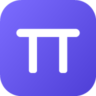
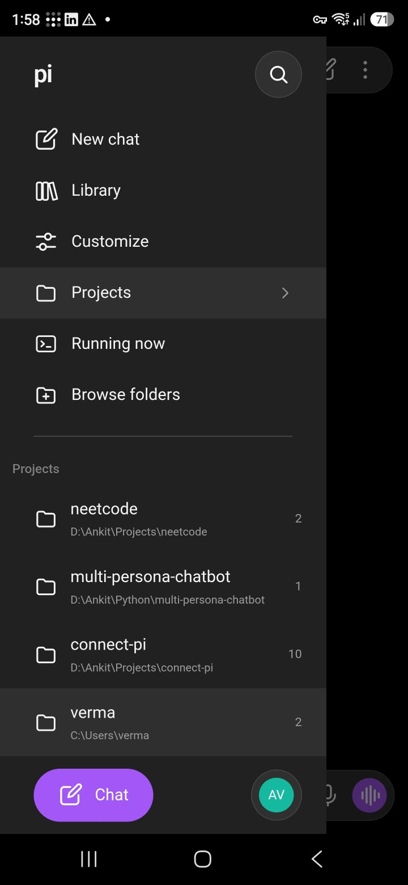
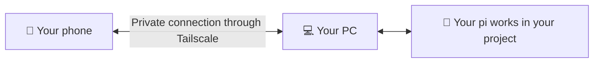
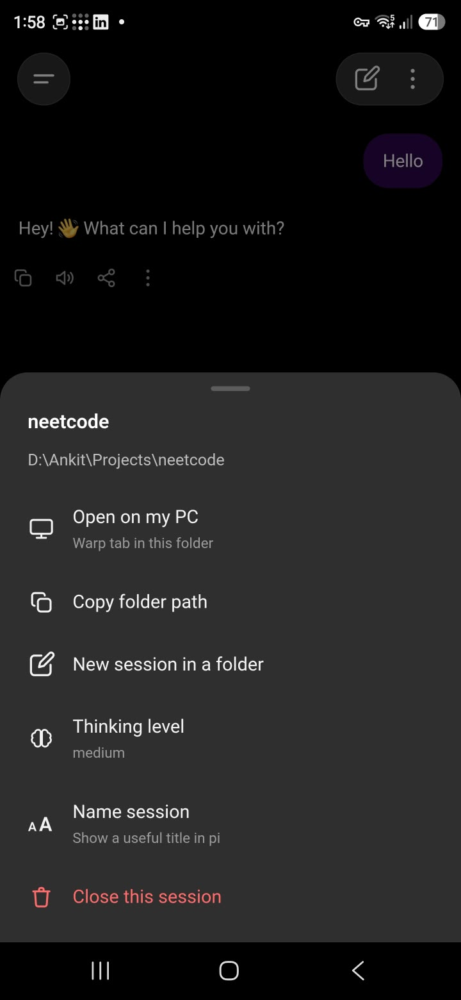

<p align="center"></p>

<h1 align="center">Your pi. Now in your pocket.</h1>

<p align="center"><strong>Give your coding assistant a task from your phone.<br />Watch it work on your PC. Continue the conversation wherever you are.</strong></p>

<p align="center">Project-based chats · Live replies · Your own pi account · A familiar mobile interface</p>

## 💜 Leave the desk. Keep the conversation.

An idea hits while you're on the sofa. A task is still running while you make coffee. You want to ask one more question without opening your laptop again.

**connect-pi gives the pi on your PC a comfortable phone interface.** Your computer does the work. Your phone lets you follow along.

- **Talk to your own pi.** Use the saved account setup on your computer.
- **Keep projects together.** Find conversations by project folder.
- **See progress live.** Read replies and expand commands or thinking steps.
- **Change direction.** Send a follow-up while pi works, or press Stop.
- **Carry on later.** Reopen a saved conversation from your phone.

> An independent companion for pi, with a ChatGPT-inspired interface. This is not a ChatGPT product.

## 👀 Take a look

<p align="center">


</p>

*Screenshots supplied for this guide. Your projects and messages will be your own.*

## 🧭 How it works



**You send a message → pi works on your PC → the reply appears on your phone.**

Tailscale privately connects your phone and PC, even on different networks. Your PC must stay switched on, connected and awake.

## ✅ Can I use this with my own pi?

**Yes, with a compatible setup. You do not need the author's computer or AI account.**

| You need | Why |
| --- | --- |
| A Windows PC | The desktop launcher and this guide are built for Windows. |
| pi working on that PC | connect-pi controls pi; it does not provide an AI account. |
| Node.js LTS, version 22.19 or newer | Runs pi and connect-pi. Includes the `npm` command used below. |
| Android or iPhone with a current browser | Opens the phone interface. Android is the main UI reference; iPhone behavior can differ. |
| Tailscale on the PC and phone | Connects your devices privately. |
| Access to this repository | It is currently private. Other people need an invitation to download it. |

This guide uses an **npm-installed pi**. Custom or standalone pi installations may need extra configuration. macOS and Linux are not covered by this Windows guide or verified as complete desktop experiences.

## 🚀 Set it up once

Do steps 1–6 on your **PC**. Switch to your **phone** at step 7. Copy and run commands one at a time.

### 1. Make sure pi works

Install [Node.js LTS](https://nodejs.org/en/download) if needed, then open a new PowerShell window. Check its version:

```powershell
node --version
```

You should see **22.19 or newer**. If pi already works, skip its installation below. Otherwise, use the npm installation from [pi's official guide](https://github.com/earendil-works/pi/tree/main/packages/coding-agent):

```powershell
npm.cmd install -g --ignore-scripts @earendil-works/pi-coding-agent
```

Start pi:

```powershell
pi
```

Inside pi, type `/login` and follow its sign-in steps if you have not connected your AI provider. Send **“Say hello.”** Continue once pi replies. Your provider's normal charges and usage limits still apply.

### 2. Connect your devices with Tailscale

1. [Download Tailscale](https://tailscale.com/download) on the PC and phone.
2. Sign in on both with the **same Tailscale account**.
3. Keep Tailscale connected on both devices.
4. Follow [Tailscale's HTTPS setup guide](https://tailscale.com/docs/how-to/set-up-https-certificates) to enable HTTPS.

HTTPS gives you the address needed for phone installation and fingerprint unlock. If Tailscale asks you to approve serving a private web page, follow its approval link. See [Tailscale Serve](https://tailscale.com/docs/features/tailscale-serve) for help.

### 3. Download connect-pi

1. Open [this repository](https://github.com/vermaankit2005/connect-pi) while signed into GitHub.
2. Click **Code → Download ZIP**.
3. Right-click the ZIP and choose **Extract All**.
4. Open the extracted folder containing `package.json`.
5. Right-click an empty area in that folder and choose **Open in Terminal**.

Keep this folder somewhere permanent. The desktop shortcut will use it later.

### 4. Run the setup

In that terminal, run:

```powershell
npm.cmd install
```

Wait until it finishes, then run:

```powershell
npm.cmd run setup
```

Choose a **6-digit passcode** when asked. You will use it to unlock the phone app. Setup also adds the connection extension to pi and creates the app icons.

If pi was already open, restart it or type `/reload` inside pi. Continue when setup finishes without an error.

### 5. Choose where your projects live

The phone's folder browser initially looks on **D:**. If your projects are there, skip this step. If you use **C:** or another location, change it now:

1. Press **Windows + R**.
2. Enter `%USERPROFILE%\.connect-pi.json` and open it with Notepad.
3. Find the setting named `roots`.
4. Replace its folder list with the folder you want to browse. Keep everything else unchanged.

For example, if your actual folder is `C:\Users\Jamie\Projects`, that part should look like:

```json
"roots": ["C:\\Users\\Jamie\\Projects"],
```

Use **your actual Windows username and an existing folder**. Keep the doubled backslashes shown above. Save and close Notepad. Do not share this file: it also contains private sign-in information.

### 6. Add your desktop button and start

Back in the connect-pi terminal, run:

```powershell
npm.cmd run desktop
```

A shortcut named **pi on my phone** appears on your desktop. Double-click it. A window opens and shows the address to use on your phone.

Look for an address beginning with **`https://`** and ending in **`.ts.net`**. Keep this window open while using connect-pi.

Prefer a terminal? Run `npm.cmd start` from the app folder instead. If no HTTPS address appears, see troubleshooting below.

### 7. Open it on your phone

1. Make sure **Tailscale is connected** on the phone.
2. Open Chrome on Android, or Safari on iPhone.
3. Enter the **exact address printed by the PC**, without adding a different port.
4. Enter your 6-digit passcode.

**You should now see the chat screen.** Open the top-left menu to see Projects. An empty list is normal before your first conversation.

### 8. Put it on your home screen

- **Android:** In Chrome's three-dot menu, choose **Install app** or **Add to Home screen**, whichever appears.
- **iPhone:** Tap **Share → Add to Home Screen** and follow your iOS version's options.

Open that icon next time. You still need Tailscale connected and the PC window running. Installation and fingerprint options depend on your browser and a working HTTPS address.

## 💬 Your first task

1. On the phone, open the top-left menu.
2. Tap **New project** to browse your PC's folders.
3. Choose an existing project folder, or tap **New folder** to create one.
4. Tap **Start pi here** and wait for it to start.
5. Type **“Explain what this project does.”**
6. Tap the purple **Send** arrow and watch the reply arrive.

**A project is a folder on your PC.** This does not move files or upload them to GitHub. The empty purple waveform starts browser dictation where supported; typing changes it to Send. This is dictation, not ChatGPT voice chat.

## 📁 Continue a conversation

1. Open the menu. **Projects is the starting view after opening the app.**
2. Tap a project to see its conversations.
3. Tap a running conversation to switch to it.
4. Tap a saved conversation, then **Continue this session** to reopen it.
5. Choose **Start fresh in this folder** for a new conversation instead.

Long conversations can cost more to continue because pi remembers earlier messages. **Library** shows chats across projects. The magnifying glass searches titles and folders. The menu and project list scroll together.

## ☀️ Everyday use

Open the three dots at the top-right of a chat for session options: change its thinking level, give it a name, open its folder on your PC, or close a phone-started session. Desktop handoff uses Warp.

<p align="center"></p>

| I want to… | Do this |
| --- | --- |
| Start using it today | Open **pi on my phone** on the PC, connect Tailscale on the phone, then open the app. |
| Start another chat | Open a project and tap **New chat in project**. |
| Change direction while pi works | Send another message while it is working. |
| Stop the task | With an empty message box, tap the **Stop** square. Cancellation can take a moment. |
| Read a command or thinking step | Tap its collapsed row in the conversation. |
| Add a text or code file | Tap **+ → Files**. Review the contents added to your draft before sending. |
| See open sessions | Open **Running now** in the sidebar. |
| Change theme, text size or bubble color | Tap the round account button at the bottom of the sidebar to open Settings. |
| Use fingerprint unlock | Enable it in Settings if available on your phone's HTTPS address. |
| Turn it off | Close the PC's connect-pi window. Sessions it started stop; saved history stays. |

The phone is a remote control: pi still works with your PC account's permissions. Keep your passcode and Tailscale account private. Your AI provider still receives whatever pi normally sends it; connect-pi does not make AI requests stay entirely on your computer.

## 🛟 Something not working?

| What you see | Try this |
| --- | --- |
| GitHub says “404” | Sign into an invited account or ask the owner for repository access. |
| “npm is not recognized” | Install Node.js, then reopen the terminal. |
| PowerShell says scripts are disabled | Use **`npm.cmd`** as shown above instead of `npm`. You do not need to change Windows security settings. |
| “pi is not recognized” | Complete step 1, then reopen the terminal. If PowerShell blocks `pi.ps1`, try `pi.cmd`. |
| The PC says “pi found: NO” | Check step 1. Custom installations need the technical guide. |
| The phone cannot open the page | Check that the PC is awake, its window is open, and Tailscale is connected on both devices. Recheck the address. |
| No HTTPS address appears | Complete Tailscale's HTTPS/Serve approval, then restart connect-pi. An `http://100…` address supports a passcode, but installation and fingerprint unlock need HTTPS. |
| No folders appear | Check step 5. The default D: drive may not exist. Restart connect-pi after changing folders. |
| Projects is empty | Start a chat in a folder. Projects appear once a session/history exists. |
| A session does not appear | Run `npm.cmd run install-extension` in the app folder, then restart pi or use `/reload`. |
| Forgot the passcode | Run `npm.cmd run passcode` in the app folder on the PC. Phones must sign in again. |
| pi is waiting for permission | Check the desktop pi window. The phone cannot answer every prompt from other pi extensions. |

## 🙋 A few honest answers

**Does pi run on my phone?**

No. It runs on your PC, which must stay on, awake and connected.

**Can someone else use their own pi?**

Yes, with the compatible Windows/npm setup above, their own pi login, repository access and their own Tailscale account. They set it up on their own PC. Not every pi version, custom extension or operating system has been verified.

**Do I need another AI subscription?**

connect-pi uses pi's saved account setup. Your provider's billing and limits still apply. Tailscale has its own plans and eligibility; check its website for your situation.

**Can I use an API key?**

Use pi's supported saved provider setup. Phone-launched sessions currently clear the `OPENAI_API_KEY` environment variable, so relying only on that variable needs adjustment. See the technical guide for custom configurations.

**Can anyone download it today?**

The repository is private. The owner must give other users access first.

**How do I update?**

For ZIP downloads, download a fresh copy and replace the app files in the same permanent folder. Keep the old copy until you have checked the update. Your login settings live separately in your Windows user folder, and pi keeps its own conversations.

Open a terminal in the app folder and run these commands one at a time:

```powershell
npm.cmd install
```

```powershell
npm.cmd run install-extension
```

Restart connect-pi and restart pi (or use `/reload`), then refresh the phone app.

---

**Ready? Start with [step 1](#1-make-sure-pi-works). Your next conversation can start from your phone.**

For custom installations, home-WiFi access and developer details, read the [technical guide](docs/technical-guide.md).
